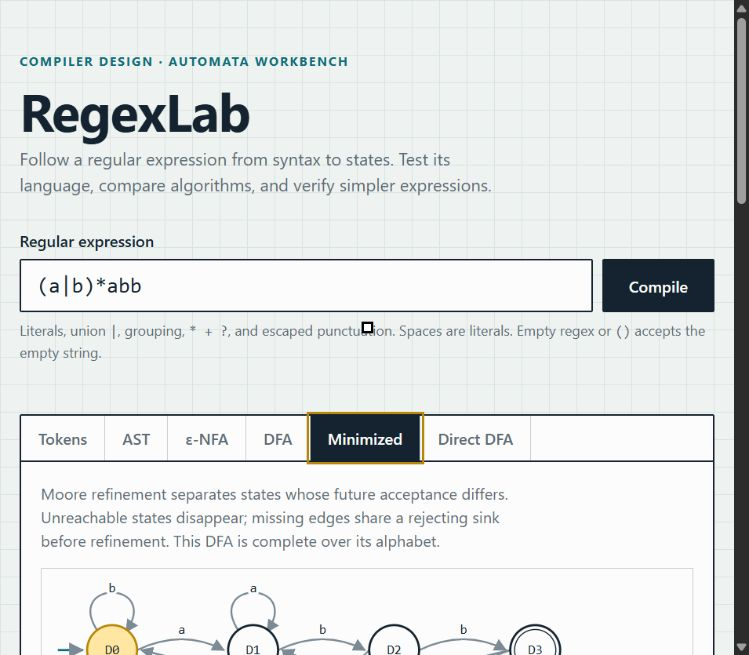

# RegexLab — Regex-to-DFA Compiler

A C++17 compiler and interactive automata workbench. Compile a regular expression through a lexer, recursive-descent parser, AST, Thompson ε-NFA, subset DFA, and minimized DFA. An independent direct DFA implementation uses nullable, firstpos, lastpos, and followpos.

The existing C++ modules and vanilla web frontend are preserved. The web interface now calls the real compiler through a dependency-free local Node server.



## Features

- Positioned tokens, AST diagrams/text trees, ε-NFA and DFA diagrams, searchable transition/state-set tables.
- Full-string DFA matching and ε-NFA simulation; execution steps highlight active states.
- Moore DFA minimization with reachable-state discovery, completion, and dead-state merging.
- Direct position construction, with nullable/firstpos/lastpos/followpos inspection.
- Structural language-equivalence checks for both constructions and both minimized DFAs.
- Breadth-first product-DFA equivalence checking with shortest counterexamples, including ε.
- Safe simplifications accepted only after AST-size reduction and language-equivalence proof.
- Repeated algorithm comparisons; reproducible benchmarks with raw measurements.
- Automated correctness/HTTP tests and a GitHub Actions workflow.

## Quick start

Requirements: a C++17-capable GNU compiler (`g++`) and Node.js 18 or newer. No npm packages or Python dependencies are needed. GCC 6.3 and Node were used for local verification; CI is configured for Ubuntu and Node 22.

```sh
git clone https://github.com/PrabhavGomase/regex-to-dfa-compiler.git
cd regex-to-dfa-compiler
node scripts/build.js
node scripts/test.js
node scripts/server.js
```

Open **http://127.0.0.1:3000**. Keep the server terminal running; stop it with Ctrl+C. Set `PORT` to choose a different local port. Set `CXX` to another GNU-compatible compiler executable, such as `clang++`, before building.

The same commands work in PowerShell. If npm is installed, `npm run build`, `npm test`, `npm start`, and `npm run benchmark` are equivalent shortcuts. There is no installation step.

Optional CMake build for the C++ portion:

```sh
cmake -S . -B build -DCMAKE_BUILD_TYPE=Release
cmake --build build --config Release
ctest --test-dir build -C Release --output-on-failure
```

The Node server expects the compiler at `build/regexlab` (`build/regexlab.exe` on Windows). Multi-configuration CMake generators place executables in subdirectories; use the Node build for the web interface. CMake was not available for local verification.

## CLI

On Windows, substitute `./build/regexlab.exe` for `./build/regexlab`.

```sh
./build/regexlab
./build/regexlab --json '(a|b)*abb' 'aabb'
./build/regexlab --compare '(a|b)*abb'
./build/regexlab --optimize '(a|a)*'
./build/regexlab --equivalent 'a*' 'a+'
./build/regexlab --benchmark 20
```

The interactive command prints the full pipeline, then accepts one test string. Other modes output JSON. Failures return an `error` object and exit status 1. The server uses `--request`: four newline-separated printable-ASCII fields on stdin (operation, regex, input, candidate). Operations are `compile`, `compare`, `optimize`, and `equivalent`.

## Supported syntax

| Expression | Meaning |
|---|---|
| `a`, `24`, `#` | Printable ASCII literals |
| `ab` | Concatenation |
| `a\|b` | Union |
| `(ab)` | Grouping |
| `a*` | Zero or more |
| `a+` | One or more |
| `a?` | Zero or one |
| Empty regex or `()` | ε: the empty-string language |
| `\*`, `\(`, <code>&#92;&#124;</code>, `\\`, `\.` | Escaped punctuation literals |

Precedence: postfix operators, then concatenation, then union. Repeated postfix operators are nested left to right: `a+?` means `(a+)?`, **not lazy matching**. All matching is against the whole string.

**Spaces are literals**, including unescaped spaces. Escape punctuation or a space with a backslash to quote it. Escaped letters/digits (`\d`, `\n`, `\1`, `\a`) are rejected rather than interpreted as shorthand classes, control sequences, or backreferences.

Unescaped `. [ ] { } ^ $` are rejected; they can be escaped for literal matching. Character classes, wildcard, counted repetition, anchors, lookaround, backreferences, Unicode, control characters, and empty alternatives (`a|`, `|a`) are unsupported. Write `(a|())` for an explicit empty alternative. Malformed syntax reports a zero-based source offset.

These rules deliberately correct the original lexer's behavior, which ignored spaces and silently treated unsupported constructs as literals.

## Examples

| Regex | Accepts | Rejects |
|---|---|---|
| `(a\|b)*abb` | `abb`, `aabb`, `babb` | ε, `ab`, `abba` |
| `a?b+` | `b`, `bb`, `abb` | ε, `a`, `ba` |
| `a\*b` | Literal `a*b` | `ab` |
| `a b` | Literal `a b` | `ab` |
| `()` | ε | Any nonempty string |

For `(a|b)*abb`: **14 NFA states → 5 subset DFA states → 4 minimized states**. Direct construction creates 4 DFA states. Equivalence is established by product traversal, not merely a few sample matches.

Subset and direct DFAs omit missing transitions. Minimized DFAs are **complete over the regex alphabet**, so they include a reachable rejecting sink when necessary. For example, `a` has a 2-state partial DFA and a 3-state complete minimized DFA. A reported negative reduction reflects completion, not a language mismatch.

## Verified optimization

Rules include duplicate union, concatenation with ε, repetition of ε, nested star/plus/optional identities, star absorbing plus or optional, and adjacent identical stars. Every candidate is reparsed, must have fewer AST nodes, and is checked by building its automaton and exploring the product with the original.

The score is **AST node count**, not source length or measured speed. Canonical output retains grouping parentheses; `a++` may become `(a)+` while still reducing tree size. The optimizer is deliberately small and does not promise a globally minimal regex.

The candidate verifier accepts any supported expression. `a*` versus `a+` returns `equivalent: false, counterexample: ""`; that empty witness is meaningful. Equivalent expressions use `counterexample: null`. Proofs that exceed resource limits produce errors and never authorize a rewrite.

## Tests and benchmarks

```sh
node scripts/build.js
node scripts/test.js
node scripts/benchmark.js 20
```

The correctness suite checks known languages, every operator, escapes, precedence, invalid syntax, explicit empty expressions, generated expressions, exhaustive short strings, all matching methods, dead/unreachable states, equivalence and shortest witnesses, optimization, execution traces, and resource limits. Standard-library `std::regex_match` supplies an independent oracle where syntax overlaps; repeated postfix extensions use independent construction checks and NFA simulation.

Recorded benchmark results: [tables and methodology](docs/benchmarks.md), [raw per-repetition data](docs/benchmark-results.json). Ten expressions cover simple cases, nesting, unions, repetition, and exponential state growth. Each method gets three warmups and twenty recorded runs, with alternating order and a high-resolution monotonic clock. Both receive the same parsed AST. NFA+subset construction and direct position construction (including tutor metadata) are measured separately from minimization. Parsing, process startup, JSON, and equivalence checking are excluded.

Times are machine-specific experimental observations. Theoretical exponential worst-case state growth is separate from those measurements. See [architecture](docs/architecture.md).

## Architecture and files

```text
src/
  lexer/ parser/ ast/    syntax and owning AST
  nfa/ dfa/             Thompson and subset construction
  direct/               syntax-tree positions and direct DFA
  minimization/         Moore partition refinement
  matcher/              DFA and ε-NFA execution traces
  analysis/             equivalence, verified optimization, benchmarking
  compiler/             pipeline integration and JSON serialization
  limits.h              state and deadline budgets
  main.cpp              interactive and JSON CLI
frontend/               existing vanilla HTML/CSS/JS workbench
scripts/                dependency-free build, server, tests, benchmarks
tests/                  C++ correctness and Node HTTP/CLI integration
docs/                   audit, architecture, measured results, screenshot
.github/workflows/      automated build and tests
```

[Initial audit](docs/audit.md) records what was actually present. [Testing notes](tests/README.md) describe verification and the browser checks.

## Limits and tradeoffs

- Printable ASCII only, up to 256 regex bytes and 4,096 test-string bytes.
- At most 512 states per construction, a conservative 2,048-state NFA budget, and 100,000 equivalence-product pairs. Completing a DFA may add one sink.
- Two-second cooperative deadlines for automata operations; optimization also has an overall deadline. The local server kills an entire request after 15 seconds and accepts at most two concurrent compilations.
- Benchmark CLI repetitions are bounded at 100; the recording runner has a 120-second outer timeout.
- For readability, graphs fall back to tables above 40 states or 100 edges. Tables show at most 500 matching transitions; filter by state to inspect further. Trace tables show the first 300 steps; the slider covers the complete trace.
- Layout is deterministic rather than a graph-layout library; dense diagrams can have crossing edges. Complete state/transition data is available in JSON.
- Moore refinement and scan-based ε-closure favor clarity over production-scale performance. This is an educational compiler, not a drop-in PCRE/JavaScript regex engine.
- The web server binds to loopback and is intended for local use. A GitHub push publishes the source and screenshot; it does not host a live compiler website.

## License

MIT; see [LICENSE](LICENSE).
